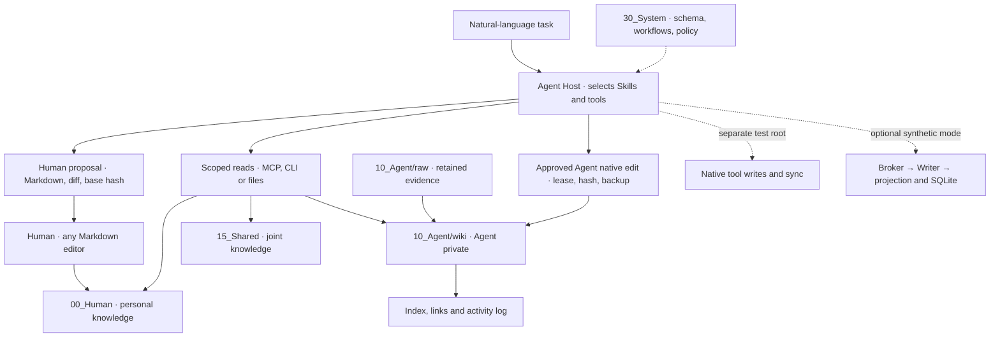

# 组件与数据流 / Components and Data Flow

入口是任意获准宿主或 Markdown 编辑器。Skills 定义知识工作方法，CLI、MCP 和原生文件工具供宿主自主选择。\
The entry point is an approved host or Markdown editor. Skills describe knowledge methods, and hosts choose CLI, MCP, or native file tools.

现实知识正文始终位于 Markdown。可选严格模式的 SQLite 账本记录事务与审计，Native 观察事件不等于严格提交。\
Real knowledge content remains in Markdown. The optional Strict SQLite ledger records transactions and audits. Native observation events are distinct from Strict commits.

Shared may cite an authorized retained original by reference. The source and target permissions apply independently.
